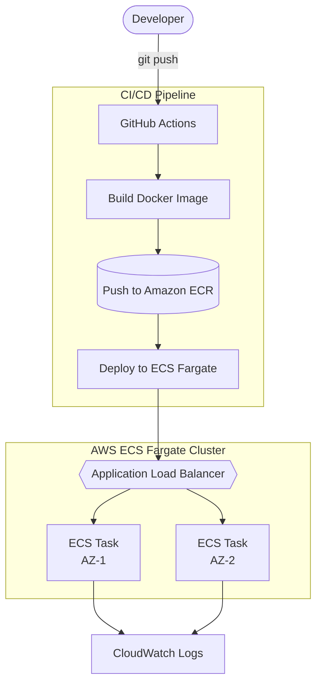

# devops-pipeline-project
# 🚀 Automated CI/CD Pipeline on AWS (ECS Fargate + Terraform + GitHub Actions)

A fully automated deployment pipeline for a containerized Node.js application. Every push to `main` automatically builds, tests, and deploys a new version to production on AWS — with zero manual steps.

## 🏗️ Architecture



### How it works

1. A developer pushes code to GitHub.
2. **GitHub Actions** builds the Docker image.
3. The image is pushed to **Amazon ECR**.
4. The new version is deployed to **ECS (Fargate)**.
5. The **Application Load Balancer** distributes traffic across tasks in two Availability Zones for high availability.
6. All tasks send their logs to **CloudWatch Logs**.


## 🛠️ Tech Stack

| Layer | Technology |
|---|---|
| Application | Node.js, Express |
| Containerization | Docker |
| Infrastructure as Code | Terraform |
| Container Registry | Amazon ECR |
| Container Orchestration | Amazon ECS (Fargate — serverless) |
| Load Balancing | Application Load Balancer |
| CI/CD | GitHub Actions |
| Monitoring | Amazon CloudWatch (Logs + Alarms) |
| Networking | Custom VPC, public subnets across 2 AZs |

## ✨ Key Features

- **Zero-downtime deployments**: Rolling updates via ECS, no manual intervention
- **Infrastructure as Code**: 100% of AWS infrastructure defined in Terraform — reproducible, version-controlled
- **Automated CI/CD**: Push to `main` → build → push to ECR → deploy to ECS, fully automatic
- **High availability**: 2 containers running across 2 Availability Zones behind a load balancer
- **Secure credential handling**: AWS credentials stored as GitHub encrypted secrets, never hardcoded
- **Health checks**: `/health` endpoint used by ALB to verify container health before routing traffic
- **Monitoring**: CloudWatch Logs for every deployment + CPU utilization alarm

## 📂 Project Structure

devops-pipeline-project/
├── index.js # Express application
├── Dockerfile # Container build instructions
├── .dockerignore
├── .github/workflows/
│ └── deploy.yml # CI/CD pipeline definition
├── terraform/
│ ├── provider.tf # AWS provider configuration
│ └── main.tf # All infrastructure (VPC, ECS, ALB, ECR, IAM)
└── README.md


## 🚀 How It Works

1. Developer pushes code to the `main` branch
2. GitHub Actions workflow triggers automatically
3. Pipeline builds a Docker image and tags it with the Git commit SHA
4. Image is pushed to Amazon ECR
5. ECS service is forced to redeploy, pulling the new image
6. ALB health checks confirm the new containers are healthy before routing traffic
7. Old containers are drained and removed

## 🖥️ Running Locally

```bash
npm install
node index.js
# App runs at http://localhost:3000
```

## 🐳 Running with Docker

```bash
docker build -t devops-pipeline-app .
docker run -p 3000:3000 devops-pipeline-app
```

## ☁️ Deploying Infrastructure

```bash
cd terraform
terraform init
terraform plan
terraform apply
```

## 📈 What I Learned

- Designing a multi-AZ, fault-tolerant AWS architecture from scratch
- Writing Infrastructure as Code with Terraform (resources, outputs, state management)
- Building a complete CI/CD pipeline with GitHub Actions
- Secure handling of cloud credentials in automated pipelines
- Debugging real pipeline failures (IAM permissions, Docker networking, ECS task health)

---
**Author:** Arham — BSCS Student
